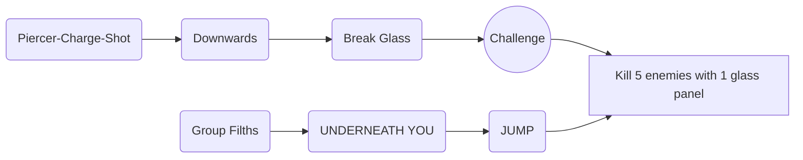

## ULTRAKILL Walkthrough

### 0-1 INTO THE FIRE

1. P-rank Requirements
   1. Time: 02:30
   2. Kills: 71
   3. Style: 7000

2. Level Summary
   
   * First weapon the **Revolver**
   * Basic Mechanics:
          1. Parries;
          2. Glass Panels;
          3. Environmental hazards and hard damage.
          
   * Introduced to Filths and Strays.
   * Fight a "Boss" Malicious Face at the end of the level.

`The **Revolver**, the first weapon.
The Revolver has 3 variants which are the Piercer, Marksman and Sharpshooter.
The Piercer is obtained in the first room in 0-1 while the other two are bought at the Terminal.´

3. Challenge 

`"Kill 5 enemies with 1 glass panel."
This challenge isn´t too hard. All you have to do to achieve it is jump and group a bunch of Filths underneath you, then do a Piercer-Charge-Shot downwards to break the glass.´

## ULTRAKILL Links e Fontes

[Link Walkthrough Steam](https://steamcommunity.com/sharedfiles/filedetails/?l=dutch&id=3203731728)

[Link Wiki](https://ultrakill.fandom.com/wiki/Home)

