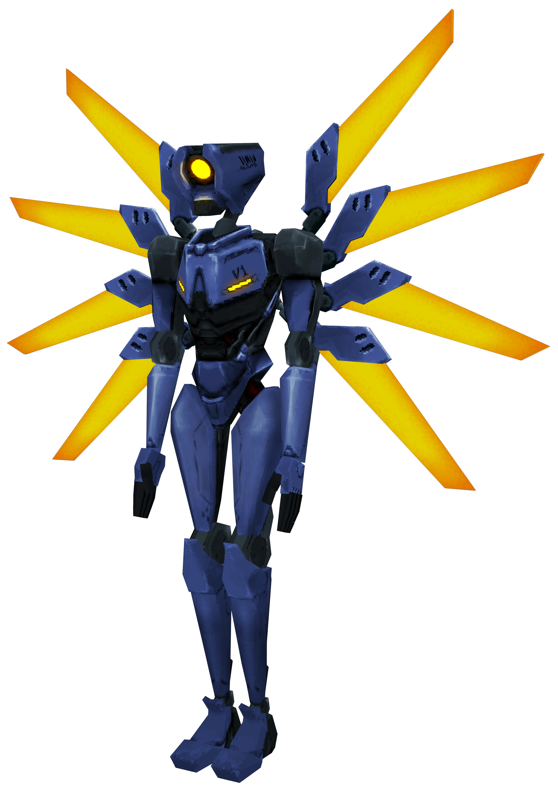
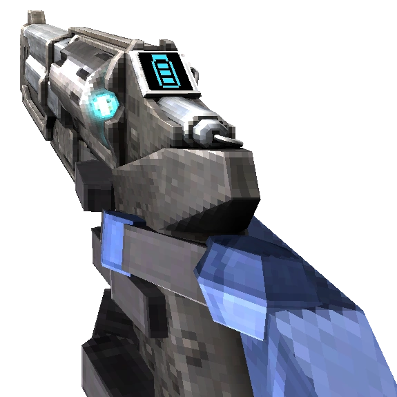
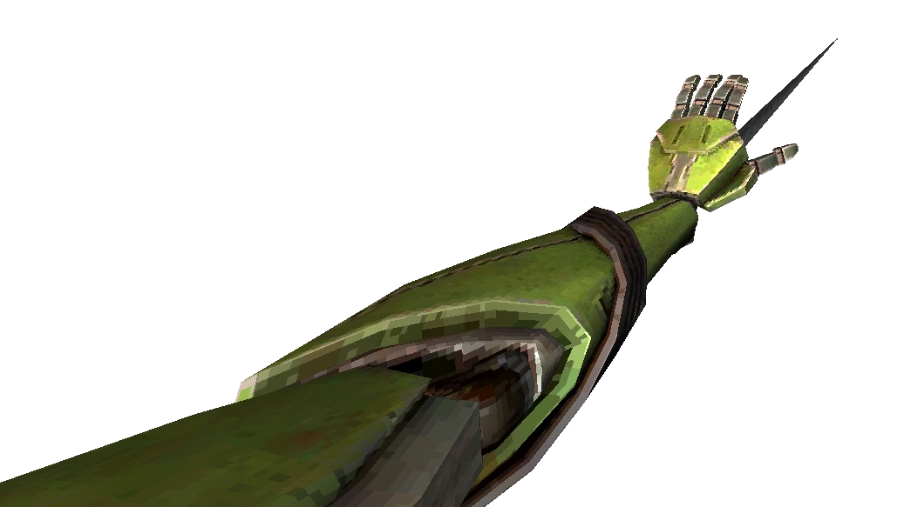
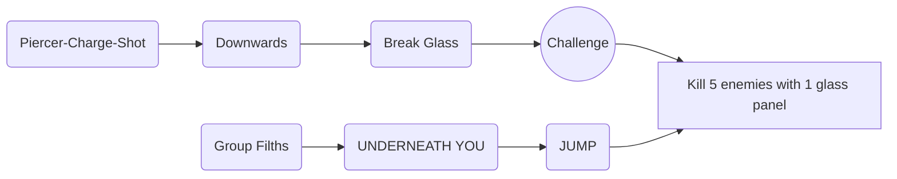

# Ultrakill Markdown

## Introduction

ULTRAKILL is a fast-paced ultraviolent old school first-person shooter developed by Arsi "Hakita" Patala and published by New Blood Interactive. You play as V1, a combat machine fueled by blood who has ventured into the depths of Hell after the extinction of humanity. Hell abounds with demons and tormented souls, sources of blood that you must rend apart in order to refuel yourself and survive.

## Characters and Items

### V1

- V1 is a Supreme Machine left to roam the Earth after the extinction of mankind, and the player character of ULTRAKILL. Like other machines, it fights in Hell for its own desperate survival after blood ran out on the surface, slaying all manner of husks, demons, angels, and other machines in order to sustain itself with the blood they shed.

### Piercer Revolver

- The Piercer Revolver is the first gun found in ULTRAKILL and is the blue variant of the Revolver, obtained in [ 0-1: INTO THE FIRE ]. It can deal moderate amounts of damage with its primary fire and can pierce through multiple weak targets or inflict concentrated damage on single targets with its secondary fire.

### Whiplash

- The Whiplash is the green variant of the Arm, generously donated by V2 and was totally not stolen from its splattered remains in [ 4-4: CLAIR DE SOLEIL ] . It pulls light enemies and objects towards V1, and pulls V1 towards heavy enemies and grapple points.

## Story

In the early 20th century, for various reasons, the nations of Earth became locked in an era of trench warfare. Called the "Final War", this event is implied to be analogous to World War I in the real world. Early in the war, the first machines to be deployed in wide-scale conflict were known as the Guttermen, one of the first successful experiments in using blood as a fuel source. Guttermen were capable of very efficiently clearing out trenches, and their creation single-handedly ended the trench phase of the Final War. In retaliation, the Guttertank was developed as a direct counter to the Guttermen, spiraling the conflict into a global arms race between the world's industrial powers. Every machine created for use in the Final War was designed to counter the last.

## ULTRAKILL Walkthrough

### 0-1 INTO THE FIRE

1. P-rank Requirements
   1. Time: 02:30
   2. Kills: 71
   3. Style: 7000

2. Level Summary
   
   * First weapon the **Revolver**
   * Basic Mechanics:
          1. Parries;
          2. Glass Panels;
          3. Environmental hazards and hard damage.
          
   * Introduced to Filths and Strays.
   * Fight a "Boss" Malicious Face at the end of the level.

`The **Revolver**, the first weapon.
The Revolver has 3 variants which are the Piercer, Marksman and Sharpshooter.
The Piercer is obtained in the first room in 0-1 while the other two are bought at the Terminal.´

3. Challenge 

`"Kill 5 enemies with 1 glass panel."
This challenge isn´t too hard. All you have to do to achieve it is jump and group a bunch of Filths underneath you, then do a Piercer-Charge-Shot downwards to break the glass.´

## ULTRAKILL Links e Fontes

[Link Walkthrough Steam](https://steamcommunity.com/sharedfiles/filedetails/?l=dutch&id=3203731728)

[Link Wiki](https://ultrakill.fandom.com/wiki/Home)

